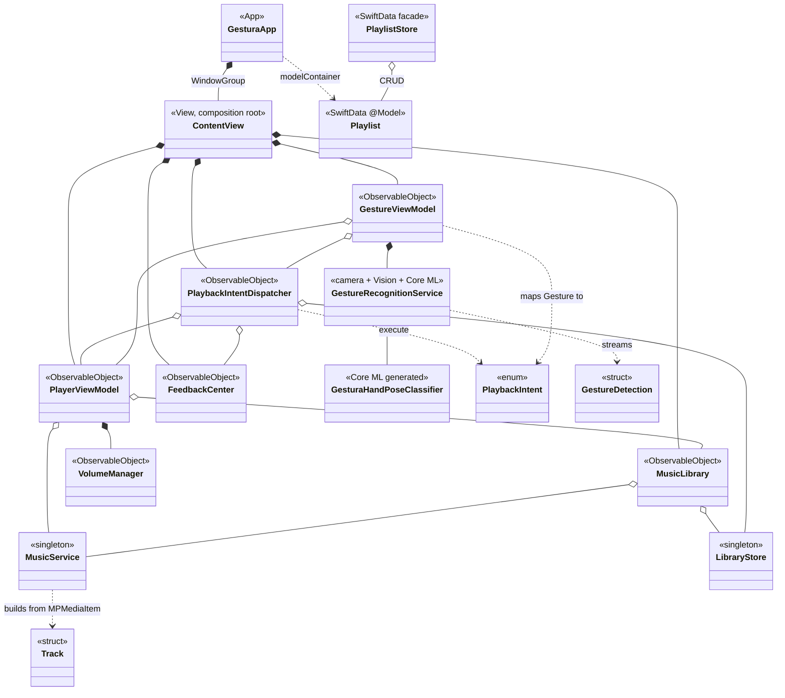
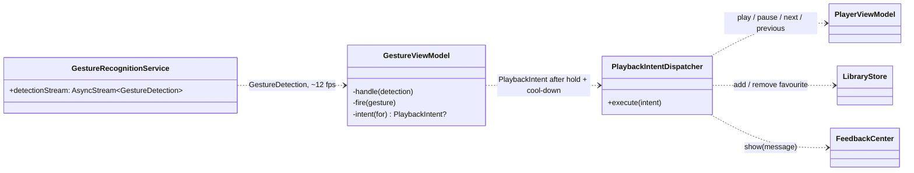

# Gestura — Class Diagram

A UML class diagram of the Gestura iOS app, generated from the source in `Gestura/`.
Every type the app declares appears below. One diagram for all ~70 types would be
unreadable, so the model is split into five views of the same system:

1. [Architecture overview](#1-architecture-overview): every non-view type and how the layers connect
2. [Domain models](#2-domain-models): `Gestura/Models`
3. [Services & view models](#3-services--view-models): `Gestura/Services`, `Gestura/ViewModels`
4. [Utilities](#4-utilities): `Gestura/Utilities`
5. [Views](#5-views): `Gestura/Views`, split into the app shell and library browsing

## Notation

| Symbol | Meaning in this diagram |
| --- | --- |
| `A *-- B` | **Composition.** A creates and owns B (`@StateObject`, or a `let` it initialises) |
| `A o-- B` | **Aggregation.** A holds a reference to a B that someone else owns (injected via `init` / `@ObservedObject`, or the `.shared` singleton) |
| `A --> B` | **Association.** A presents, navigates to or embeds B |
| `A ..> B` | **Dependency.** A uses B transiently (creates it per call, calls a static, or passes it around) |
| `A ..\|> B` | **Conformance** to a protocol |
| `+` / `-` | internal / private member |
| `$` suffix | `static` member |
| `«Published»` | `@Published` property, observed by SwiftUI |

SwiftUI `body` properties and private sub-view fragments (`private var artworkHeader: some View`)
are omitted from the view classes. Everything else is listed.

---

## 1. Architecture overview

Composition root: `ContentView.init()` builds the five long-lived objects once and
shares them down the tree, either as parameters (`viewModel`, `musicLibrary`,
`gestureViewModel`) or as environment objects (`feedbackCenter`, `dispatcher`).

### Gesture-to-playback pipeline

---

## 2. Domain models

```mermaid
classDiagram
    direction TB

    class Track {
        <<struct, Identifiable>>
        +id: MPMediaEntityPersistentID
        +title: String
        +artist: String
        +albumTitle: String
        +duration: TimeInterval
        +artwork: MPMediaItemArtwork?
        +dateAdded: Date
        +genre: String
        +lyrics: String?
    }

    class Album {
        <<struct, Identifiable>>
        +title: String
        +artist: String
        +tracks: [Track]
        +id: String «computed: artist|title»
        +artwork: MPMediaItemArtwork? «computed»
    }

    class Artist {
        <<struct, Identifiable>>
        +name: String
        +tracks: [Track]
        +id: String «computed»
        +artwork: MPMediaItemArtwork? «computed»
    }

    class Genre {
        <<struct, Identifiable>>
        +name: String
        +tracks: [Track]
        +id: String «computed»
        +artwork: MPMediaItemArtwork? «computed»
    }

    class Playlist {
        <<SwiftData @Model, final class>>
        +id: UUID
        +createdAt: Date
        +name: String
        +trackIDs: [UInt64]
        +init(id: UUID, createdAt: Date, name: String, trackIDs: [UInt64])
    }

    class PlayerState {
        <<enumeration>>
        idle
        playing(Track)
        paused(Track)
    }

    class RepeatMode {
        <<enumeration, String, CaseIterable>>
        off
        one
        all
    }

    class SortOption {
        <<enumeration, String, CaseIterable>>
        title
        artist
        album
        dateAdded
        +displayName: String
    }

    class AppTab {
        <<enumeration>>
        home
        library
        gestura
        search
        settings
    }

    class Gesture {
        <<enumeration, String, CaseIterable>>
        openPalm = open_palm
        pointRight = point_right
        pointLeft = point_left
        thumbsUp = thumbs_up
        thumbsDown = thumbs_down
        +displayName: String
        +sfSymbolName: String
        +actionDescription: String
    }

    class GestureDetection {
        <<struct, Sendable>>
        +gesture: Gesture
        +confidence: Double
    }

    class PlaybackIntent {
        <<enumeration>>
        togglePlayPause
        setFavorite(id: UInt64, isFavorited: Bool)
        nextTrack
        previousTrack
    }

    class RecognizerSensitivity {
        <<enumeration, String, CaseIterable>>
        relaxed
        standard
        snappy
        +appStorageKey: String$
        +settings: Settings
        +displayName: String
        +current()$ RecognizerSensitivity
    }

    class RecognizerSensitivity_Settings["RecognizerSensitivity.Settings"] {
        <<struct>>
        +holdDuration: TimeInterval
        +confidenceThreshold: Double
        +cooldown: TimeInterval
    }

    class GesturaSettings {
        <<enumeration · namespace>>
        +enabledKey: String$
        +enabledDefault: Bool$
        +isEnabled: Bool$
    }

    class OnboardingStep {
        <<enumeration, Int, CaseIterable>>
        welcome
        library
        gestures
        camera
        done
    }

    Album "1" o-- "1..*" Track
    Artist "1" o-- "1..*" Track
    Genre "1" o-- "1..*" Track
    Playlist "1" ..> "0..*" Track : trackIDs reference Track.id
    PlayerState o-- Track : associated value
    GestureDetection --> Gesture
    PlaybackIntent ..> Track : setFavorite carries Track.id
    RecognizerSensitivity *-- RecognizerSensitivity_Settings : settings
```

> `AppTab.settings` is declared but no tab uses it; Settings opens as a sheet from `HomeView`.
> `OnboardingStep` lives in `Views/Onboarding` but is a plain model enum, so it's drawn here.

---

## 3. Services & view models

```mermaid
classDiagram
    direction TB

    class MusicService {
        <<ObservableObject, singleton>>
        +shared: MusicService$
        +isAuthorized: Bool «Published»
        -player: MPMusicPlayerController
        +currentPlaybackTime: TimeInterval «computed»
        +playbackState: MPMusicPlaybackState «computed»
        +nowPlayingItem: MPMediaItem? «computed»
        -init()
        +seek(to: TimeInterval)
        +requestAuthorization() async Bool
        +requestAuthorization(completion: Bool callback)
        +startObserving()
        +stopObserving()
        +moveInSystemQueue(track: Track, after: Track?)
        +removeFromSystemQueue(tracks: [Track])
        +fetchAllSongs() [Track]
        -fetchMediaItem(for: Track) MPMediaItem?
        +play(tracks: [Track], startingAt: Int)
        +pause()
        +resume()
        +nextTrack()
        +previousTrack()
        +setRepeatMode(mode: RepeatMode)
        +setShuffleMode(enabled: Bool)
    }

    class LibraryStore {
        <<ObservableObject, singleton>>
        +shared: LibraryStore$
        +favoriteIDs: Set~UInt64~ «Published»
        +recentlyPlayedIDs: [UInt64] «Published»
        -defaults: UserDefaults
        -favoritesKey: String
        -recentlyPlayedKey: String
        -maxRecentCount: Int = 20
        -init()
        +loadFavorites()
        +loadRecentlyPlayed()
        +addFavorite(id: UInt64)
        +removeFavorite(id: UInt64)
        +toggleFavorite(id: UInt64)
        +addToRecentlyPlayed(id: UInt64)
        +isFavorite(id: UInt64) Bool
        +clearFavorites()
        +clearRecentlyPlayed()
    }

    class PlaylistStore {
        <<MainActor, final>>
        -context: ModelContext
        +init(context: ModelContext)
        +setTrackIDs(ids: [UInt64], for: Playlist)
        +createPlaylist(name: String) Playlist
        +renamePlaylist(playlist: Playlist, newName: String)
        +deletePlaylist(playlist: Playlist)
        +addTrack(trackID: UInt64, to: Playlist)
        +removeTrack(trackID: UInt64, from: Playlist)
        +moveTrack(in: Playlist, from: IndexSet, to: Int)
        -tryToSave()
    }

    class FeedbackCenter {
        <<ObservableObject, MainActor, final>>
        +message: String? «Published»
        +trigger: Int «Published»
        -dismissTask: Task~Void, Never~?
        +show(message: String)
    }

    class PlaybackIntentDispatcher {
        <<ObservableObject, MainActor, final>>
        -player: PlayerViewModel
        -library: LibraryStore
        -feedback: FeedbackCenter
        +init(player, library, feedback)
        +execute(intent: PlaybackIntent)
    }

    class VolumeManager {
        <<NSObject, ObservableObject, MainActor>>
        +volume: Float «Published»
        -pollingTask: Task~Void, Never~?
        -volumeView: MPVolumeView
        +init()
        +setVolume(newVolume: Float)
        -readInitialVolume()
        -startPollingSliderValue()
    }

    class GestureRecognitionService {
        <<NSObject, final>>
        +detectionStream: AsyncStream~GestureDetection~
        -detectionContinuation: AsyncStream~GestureDetection~.Continuation
        +statusStream: AsyncStream~FrameStatus~
        -statusContinuation: AsyncStream~FrameStatus~.Continuation
        -lastStatus: FrameStatus?
        -captureSession: AVCaptureSession
        -sessionQueue: DispatchQueue
        -processingQueue: DispatchQueue
        -videoDataOutput: AVCaptureVideoDataOutput?
        -isConfigured: Bool
        -shouldBeRunning: Bool
        -lastProcessedTime: CFTimeInterval
        -frameProcessingInterval: CFTimeInterval = 1/12 s
        -inferenceOrientation: CGImagePropertyOrientation$ = leftMirrored
        -handPoseRequest: VNDetectHumanHandPoseRequest
        -handPoseClassifier: GesturaHandPoseClassifier?
        +orientationDiagnosticEnabled: Bool$ «DEBUG»
        +requestCameraAuthorization()$ async Bool
        +start() async StartResult
        +stop()
        -sessionWasInterrupted(notification)
        -sessionInterruptionEnded(notification)
        -configureSessionSync()
        +captureOutput(output, didOutput: CMSampleBuffer, from: AVCaptureConnection)
        -emitStatus(status: FrameStatus)
        +runOrientationSweep(on: CVPixelBuffer, at: CFTimeInterval) «DEBUG»
    }

    class GRS_StartResult["GestureRecognitionService.StartResult"] {
        <<enumeration>>
        started
        cameraDenied
        modelUnavailable
    }

    class GRS_FrameStatus["GestureRecognitionService.FrameStatus"] {
        <<enumeration>>
        noHand
        handDetected
    }

    class AVCaptureVideoDataOutputSampleBufferDelegate {
        <<protocol · AVFoundation>>
    }

    class GesturaHandPoseClassifier {
        <<Core ML generated>>
        +prediction(poses: MLMultiArray) Output
    }

    class MusicLibrary {
        <<ObservableObject, MainActor>>
        -libraryStore: LibraryStore
        -musicService: MusicService
        +permissionDenied: Bool «Published»
        +hasLoaded: Bool «Published, read-only»
        +songs: [Track] «Published, read-only»
        +tracksByID: [UInt64: Track] «read-only»
        +recentlyPlayedTracks: [Track] «computed»
        +favoriteTracks: [Track] «computed»
        +artists: [Artist] «computed»
        +albums: [Album] «computed»
        +genres: [Genre] «computed»
        +requestAccess() async
        +loadSongs()
        -fetchSongs()
        +addToRecentlyPlayed(id: UInt64)
    }

    class PlayerViewModel {
        <<ObservableObject, MainActor>>
        -timerTask: Task~Void, Never~?
        -pendingReconcileTask: Task~Void, Never~?
        -musicService: MusicService
        -nowPlayingObserver: NSObjectProtocol?
        -playbackStateObserver: NSObjectProtocol?
        -originalQueue: [Track]
        -musicLibrary: MusicLibrary
        +volumeManager: VolumeManager
        +playerState: PlayerState «Published»
        +repeatMode: RepeatMode «Published»
        +currentTime: TimeInterval «Published»
        +isScrubbing: Bool «Published»
        +scrubTime: TimeInterval «Published»
        +queue: [Track] «Published»
        +queueIndex: Int «Published»
        +isShuffleEnabled: Bool «Published»
        +currentTrack: Track? «computed»
        +isPlaying: Bool «computed»
        +currentQueueTrack: Track? «computed»
        +pendingStart: PendingStart «computed»
        +init(musicLibrary: MusicLibrary)
        +setRepeatMode(mode: RepeatMode)
        +observeNowPlaying()
        -handlePlaybackStateChange()
        -reconcilePlaybackState()
        +stageForScreenshots(queue: [Track], playingIndex: Int, at: TimeInterval)
        +play(track: Track, in: [Track])
        +startPlayback() StartPlaybackResult
        +nextTrack()
        +previousTrack()
        +cycleRepeatMode()
        +togglePlayPause() Bool?
        +toggleShuffle()
        +setShuffleEnabled(enabled: Bool)
        +startScrubbing()
        +scrub(to: TimeInterval)
        +endScrubbing()
        +removeQueueItem(at: IndexSet)
        +moveQueueItems(from: IndexSet, to: Int)
        -updateNowPlaying()
        -playCurrentQueueTrack()
        +jumpTo(index: Int)
        -startTimer()
        -stopTimer()
    }

    class PVM_StartPlaybackResult["PlayerViewModel.StartPlaybackResult"] {
        <<enumeration>>
        started(Track)
        libraryLoading
        libraryEmpty
        accessDenied
    }

    class PVM_PendingStart["PlayerViewModel.PendingStart"] {
        <<enumeration>>
        resume(Track)
        shuffleLibrary
        libraryLoading
        libraryEmpty
        accessDenied
    }

    class GestureViewModel {
        <<ObservableObject, MainActor, final>>
        +lastDetectedGesture: Gesture? «Published»
        +isRunning: Bool «Published, read-only»
        +unavailableReason: UnavailableReason? «Published, read-only»
        +liveStatus: LiveStatus «Published, read-only»
        -service: GestureRecognitionService
        -dispatcher: PlaybackIntentDispatcher
        -player: PlayerViewModel
        -consumerTask: Task~Void, Never~?
        -statusConsumerTask: Task~Void, Never~?
        -flashResetTask: Task~Void, Never~?
        -currentlyHeldGesture: Gesture?
        -holdStartTime: CFTimeInterval?
        -hasFiredForCurrentHold: Bool
        -lastFiredAt: [Gesture: CFTimeInterval]
        -flashDuration: Duration = 1500 ms
        -chimeEnabledKey: String
        -detectionChimeSoundID: SystemSoundID = 1057
        +init(dispatcher: PlaybackIntentDispatcher, player: PlayerViewModel)
        +start() async
        +stop()
        -handle(detection: GestureDetection)
        -handle(status: FrameStatus)
        -fire(gesture: Gesture)
        -intent(for: Gesture) PlaybackIntent?
    }

    class GVM_UnavailableReason["GestureViewModel.UnavailableReason"] {
        <<enumeration>>
        cameraDenied
        modelUnavailable
    }

    class GVM_LiveStatus["GestureViewModel.LiveStatus"] {
        <<enumeration>>
        idle
        noHand
        handDetected
    }

    %% nested types
    GestureRecognitionService *-- GRS_FrameStatus : nested
    GestureRecognitionService ..> GRS_StartResult : nested, returned by start
    GestureRecognitionService ..|> AVCaptureVideoDataOutputSampleBufferDelegate
    GestureRecognitionService *-- GesturaHandPoseClassifier
    PlayerViewModel ..> PVM_StartPlaybackResult : nested
    PlayerViewModel ..> PVM_PendingStart : nested
    GestureViewModel *-- GVM_UnavailableReason : nested
    GestureViewModel *-- GVM_LiveStatus : nested

    %% ownership and references
    PlayerViewModel o-- MusicLibrary
    PlayerViewModel o-- MusicService
    PlayerViewModel *-- VolumeManager
    MusicLibrary o-- MusicService
    MusicLibrary o-- LibraryStore
    PlaybackIntentDispatcher o-- PlayerViewModel
    PlaybackIntentDispatcher o-- LibraryStore
    PlaybackIntentDispatcher o-- FeedbackCenter
    GestureViewModel *-- GestureRecognitionService
    GestureViewModel o-- PlaybackIntentDispatcher
    GestureViewModel o-- PlayerViewModel

    %% models used
    class Track
    class Playlist
    class PlayerState
    class RepeatMode
    class Gesture
    class GestureDetection
    class PlaybackIntent
    class RecognizerSensitivity
    class Artist
    class Album
    class Genre

    MusicService ..> Track : creates
    MusicService ..> RepeatMode
    PlaylistStore ..> Playlist : inserts, edits, deletes
    PlayerViewModel *-- PlayerState
    PlayerViewModel *-- RepeatMode
    PlayerViewModel "1" o-- "0..*" Track : queue
    MusicLibrary "1" o-- "0..*" Track : songs
    MusicLibrary ..> Artist : groups into
    MusicLibrary ..> Album : groups into
    MusicLibrary ..> Genre : groups into
    GestureRecognitionService ..> GestureDetection : yields
    GestureRecognitionService ..> RecognizerSensitivity : confidenceThreshold
    GestureViewModel ..> RecognizerSensitivity : holdDuration, cooldown
    GestureViewModel ..> Gesture
    GestureViewModel ..> PlaybackIntent : creates
    PlaybackIntentDispatcher ..> PlaybackIntent : executes
```

---

## 4. Utilities

```mermaid
classDiagram
    direction TB

    class ArtworkCacheKey {
        <<NSObject, final>>
        +persistentID: MPMediaEntityPersistentID
        +size: Int
        +init(persistentID, size: Int)
        +hash: Int «override»
        +isEqual(object: Any?) Bool
    }

    class ArtworkCache {
        <<final, singleton>>
        +shared: ArtworkCache$
        -cache: NSCache~ArtworkCacheKey, UIImage~ «50 MB limit»
        -init()
        +image(for: MPMediaEntityPersistentID, size: Int) UIImage?
        +setImage(image: UIImage, for: MPMediaEntityPersistentID, size: Int)
    }

    class ArtworkLoader {
        <<ObservableObject, MainActor, final>>
        +image: UIImage? «Published, read-only»
        -task: Task~Void, Error~?
        +load(artwork: MPMediaItemArtwork?, persistentID, size: Int)
        +cancel()
    }

    class ArtworkView~Placeholder~ {
        <<View, generic>>
        +artwork: MPMediaItemArtwork?
        +persistentID: MPMediaEntityPersistentID
        +size: CGFloat
        +placeholder: builder returning Placeholder
        -loader: ArtworkLoader «StateObject»
        +init(artwork, persistentID, size) «where Placeholder == DefaultArtworkPlaceholder»
    }

    class DefaultArtworkPlaceholder {
        <<View>>
    }

    class FeedbackHUD {
        <<View>>
        -feedbackCenter: FeedbackCenter «EnvironmentObject»
    }

    class PlayShuffleToolbarButtons {
        <<ToolbarContent>>
        +tracks: [Track]
        +viewModel: PlayerViewModel
    }

    class SortOptionMenu {
        <<ToolbarContent>>
        +selection: SortOption «Binding»
    }

    class VolumeSliderView {
        <<UIViewRepresentable>>
        +makeUIView(context) MPVolumeView
        +updateUIView(uiView: MPVolumeView, context)
    }

    class ScreenshotMode {
        <<enumeration · namespace>>
        +isActive: Bool$
        -albums: [DemoAlbum]$
        -demoLyrics: String$
        +demoTracks: [Track]$
        +stage(player: PlayerViewModel, libraryStore: LibraryStore)$
        -makeArtwork(colors: [UIColor], symbol: String)$ MPMediaItemArtwork
    }

    class ScreenshotMode_DemoAlbum["ScreenshotMode.DemoAlbum"] {
        <<struct>>
        +title: String
        +artist: String
        +genre: String
        +colors: [UIColor]
        +symbol: String
        +songs: [String, TimeInterval]
    }

    class GlobalFunctions {
        <<free functions>>
        +log(items: Any..., separator: String) «Log.swift, DEBUG only»
        +formatTime(time: TimeInterval) String «TimeFormatter.swift»
    }

    class FeedbackCenter
    class PlayerViewModel
    class LibraryStore
    class SortOption
    class Track

    ArtworkCache "1" *-- "0..*" ArtworkCacheKey : keys
    ArtworkLoader ..> ArtworkCache : reads / writes shared
    ArtworkView *-- ArtworkLoader
    ArtworkView ..> DefaultArtworkPlaceholder : default placeholder
    FeedbackHUD o-- FeedbackCenter
    PlayShuffleToolbarButtons o-- PlayerViewModel
    PlayShuffleToolbarButtons o-- Track
    SortOptionMenu --> SortOption
    ScreenshotMode *-- ScreenshotMode_DemoAlbum : nested
    ScreenshotMode ..> Track : builds demoTracks
    ScreenshotMode ..> PlayerViewModel : stageForScreenshots
    ScreenshotMode ..> LibraryStore : seeds favourites, recents
```

> `VolumeSliderView` is declared but no view uses it; `NowPlayingView` drives volume through
> `PlayerViewModel.volumeManager` instead. `ScreenshotMode` is only active when the app is launched
> with `-GesturaScreenshots`.

---

## 5. Views

All views are SwiftUI `struct`s conforming to `View`. Two objects reach almost every
screen, so they are listed as members rather than drawn as edges:

- `viewModel: PlayerViewModel` (`@ObservedObject`)
- `musicLibrary: MusicLibrary` (`@ObservedObject`)

`FeedbackCenter` and `PlaybackIntentDispatcher` arrive through `@EnvironmentObject`,
injected once by `ContentView`.

### 5a. App shell, player and gesture screens

```mermaid
classDiagram
    direction TB

    class ContentView {
        <<View, composition root>>
        -viewModel: PlayerViewModel «StateObject»
        -musicLibrary: MusicLibrary «StateObject»
        -feedbackCenter: FeedbackCenter «StateObject»
        -dispatcher: PlaybackIntentDispatcher «StateObject»
        -gestureViewModel: GestureViewModel «StateObject»
        -hapticFeedbackEnabled: Bool «AppStorage»
        -gesturaEnabled: Bool «AppStorage»
        -hasCompletedOnboarding: Bool «AppStorage»
        -showNowPlaying: Bool «State»
        -selectedTab: AppTab «State»
        -hudBottomPadding: CGFloat «computed»
        +init()
    }

    class ContentView_HUDLayout["ContentView.HUDLayout"] {
        <<enumeration · private namespace>>
        +tabBarHeight: CGFloat$ = 80
        +miniPlayerHeight: CGFloat$ = 62
        +bottomGap: CGFloat$ = 8
    }

    class HomeView {
        <<View>>
        -showSettings: Bool «State»
        +viewModel: PlayerViewModel «ObservedObject»
        +musicLibrary: MusicLibrary «ObservedObject»
        -isLibraryEmpty: Bool «computed»
        -recentlyPlayedTracks: [Track] «computed»
        -favoriteTracks: [Track] «computed»
    }

    class HomeView_HomeLayout["HomeView.HomeLayout"] {
        <<enumeration · private namespace>>
        +cardShadowColor: Color$
        +cardShadowRadius: CGFloat$
        +cardShadowYOffset: CGFloat$
        +featuredCardSize: CGFloat$ = 300
        +compactCardSize: CGFloat$ = 150
    }

    class HomeView_BrowseDestination["HomeView.BrowseDestination"] {
        <<enumeration, private, Identifiable>>
        playlists
        songs
        artists
        albums
        genres
        +id: String
        +title: String
        +icon: String
        +makeDestination(viewModel, musicLibrary) some View
    }

    class GesturaTabView {
        <<View>>
        -isRecognizerVisible: Bool «State»
        +viewModel: PlayerViewModel «ObservedObject»
        +gestureViewModel: GestureViewModel «ObservedObject»
        +musicLibrary: MusicLibrary «ObservedObject»
        -libraryStore: LibraryStore «ObservedObject = shared»
        -gesturaEnabled: Bool «AppStorage»
        -scenePhase: ScenePhase «Environment»
        -dispatcher: PlaybackIntentDispatcher «EnvironmentObject»
        -idleMessage(symbol, title, detail) some View
        -recoveryView(for: UnavailableReason) some View
    }

    class SearchTabView {
        <<View>>
        +viewModel: PlayerViewModel «ObservedObject»
        +musicLibrary: MusicLibrary «ObservedObject»
        -searchText: String «State»
        +filteredSongs: [Track] «computed»
        +filteredArtists: [Artist] «computed»
        +filteredAlbums: [Album] «computed»
    }

    class LibraryHubView {
        <<View>>
        +viewModel: PlayerViewModel «ObservedObject»
        +musicLibrary: MusicLibrary «ObservedObject»
    }

    class MiniPlayerView {
        <<View>>
        +viewModel: PlayerViewModel «ObservedObject»
        +onTap: callback
    }

    class NowPlayingView {
        <<View>>
        +viewModel: PlayerViewModel «ObservedObject»
        -volumeManager: VolumeManager «ObservedObject»
        -libraryStore: LibraryStore «ObservedObject = shared»
        -showQueue: Bool «State»
        -showLyrics: Bool «State»
        -dispatcher: PlaybackIntentDispatcher «EnvironmentObject»
        -hasLyrics: Bool «computed»
        +init(viewModel: PlayerViewModel)
    }

    class QueueView {
        <<View>>
        +viewModel: PlayerViewModel «ObservedObject»
        -dismiss: DismissAction «Environment»
        -queueRow(at: Int) some View
    }

    class LyricsView {
        <<View>>
        +viewModel: PlayerViewModel «ObservedObject»
        -dismiss: DismissAction «Environment»
    }

    class OnboardingView {
        <<View>>
        +musicLibrary: MusicLibrary
        -hasCompletedOnboarding: Bool «AppStorage»
        -gesturaEnabled: Bool «AppStorage»
        -step: OnboardingStep «State»
        -gesturesAppeared: Bool «State»
        -doneAppeared: Bool «State»
        -infoRow(...) some View
        -move(delta: Int)
    }

    class SettingsTabView {
        <<View>>
        +libraryStore: LibraryStore «ObservedObject = shared»
        +viewModel: PlayerViewModel «ObservedObject»
        -gesturaEnabled: Bool «AppStorage»
        -songSortingOption: SortOption «AppStorage»
        -recognizerSensitivity: RecognizerSensitivity «AppStorage»
        -detectionChimeEnabled: Bool «AppStorage»
        -hapticFeedbackEnabled: Bool «AppStorage»
        -confirmClearFavorites: Bool «State»
        -confirmClearRecentlyPlayed: Bool «State»
    }

    class GesturaPrivacyView {
        <<View>>
    }

    class FeedbackHUD
    class ArtworkView
    class SongRowView
    class PlaylistsView
    class SongListView
    class ArtistsView
    class AlbumsView
    class GenreView
    class FavoritesView
    class RecentlyPlayedView
    class AlbumDetailView
    class ArtistDetailView
    class AlbumRowView
    class ArtistRowView
    class LibrarySectionCard

    ContentView *-- ContentView_HUDLayout
    HomeView *-- HomeView_HomeLayout
    HomeView *-- HomeView_BrowseDestination

    ContentView --> HomeView : Tab home
    ContentView --> GesturaTabView : Tab gestura
    ContentView --> SearchTabView : Tab search
    ContentView --> LibraryHubView : Tab library
    ContentView --> MiniPlayerView : tab-bar accessory
    ContentView --> NowPlayingView : sheet
    ContentView --> OnboardingView : fullScreenCover
    ContentView --> FeedbackHUD : overlay

    HomeView --> SettingsTabView : sheet
    HomeView --> ArtworkView
    HomeView_BrowseDestination ..> PlaylistsView
    HomeView_BrowseDestination ..> SongListView
    HomeView_BrowseDestination ..> ArtistsView
    HomeView_BrowseDestination ..> AlbumsView
    HomeView_BrowseDestination ..> GenreView

    GesturaTabView --> ArtworkView

    SearchTabView --> SongRowView
    SearchTabView --> ArtistRowView
    SearchTabView --> AlbumRowView
    SearchTabView --> ArtistDetailView : NavigationLink
    SearchTabView --> AlbumDetailView : NavigationLink

    LibraryHubView --> LibrarySectionCard
    LibraryHubView --> PlaylistsView : NavigationLink
    LibraryHubView --> SongListView : NavigationLink
    LibraryHubView --> ArtistsView : NavigationLink
    LibraryHubView --> AlbumsView : NavigationLink
    LibraryHubView --> GenreView : NavigationLink
    LibraryHubView --> FavoritesView : NavigationLink
    LibraryHubView --> RecentlyPlayedView : NavigationLink

    NowPlayingView --> QueueView : sheet
    NowPlayingView --> LyricsView : sheet
    NowPlayingView --> FeedbackHUD : overlay
    NowPlayingView --> ArtworkView
    QueueView --> SongRowView

    SettingsTabView --> GesturaPrivacyView : NavigationLink
```

### 5b. Library browsing and playlists

```mermaid
classDiagram
    direction TB

    class SongListView {
        <<View>>
        +viewModel: PlayerViewModel «ObservedObject»
        +musicLibrary: MusicLibrary «ObservedObject»
        -songSortingOption: SortOption «AppStorage»
        +sortedSongs: [Track] «computed»
    }

    class FavoritesView {
        <<View>>
        +viewModel: PlayerViewModel «ObservedObject»
        -libraryStore: LibraryStore «ObservedObject = shared»
        +musicLibrary: MusicLibrary «ObservedObject»
        -favoritesSortingOption: SortOption «AppStorage»
        -searchText: String «State»
        +filteredSongs: [Track] «computed»
        +sortedFavorites: [Track] «computed»
    }

    class RecentlyPlayedView {
        <<View>>
        +viewModel: PlayerViewModel «ObservedObject»
        -libraryStore: LibraryStore «ObservedObject = shared»
        +musicLibrary: MusicLibrary «ObservedObject»
    }

    class ArtistsView {
        <<View>>
        +viewModel: PlayerViewModel «ObservedObject»
        +musicLibrary: MusicLibrary «ObservedObject»
        -searchText: String «State»
        +filteredArtists: [Artist] «computed»
    }

    class ArtistDetailView {
        <<View>>
        +artist: Artist
        +viewModel: PlayerViewModel «ObservedObject»
    }

    class ArtistRowView {
        <<View>>
        +artist: Artist
    }

    class AlbumsView {
        <<View>>
        +viewModel: PlayerViewModel «ObservedObject»
        +musicLibrary: MusicLibrary «ObservedObject»
        -searchText: String «State»
        +filteredAlbums: [Album] «computed»
    }

    class AlbumDetailView {
        <<View>>
        +viewModel: PlayerViewModel «ObservedObject»
        +album: Album
    }

    class AlbumRowView {
        <<View>>
        +album: Album
    }

    class GenreView {
        <<View>>
        +viewModel: PlayerViewModel «ObservedObject»
        +musicLibrary: MusicLibrary «ObservedObject»
        -searchText: String «State»
        +filteredGenres: [Genre] «computed»
    }

    class GenreDetailView {
        <<View>>
        +genre: Genre
        +viewModel: PlayerViewModel «ObservedObject»
    }

    class GenreRowView {
        <<View>>
        +genre: Genre
    }

    class PlaylistsView {
        <<View>>
        -selectedPlaylist: Playlist? «State»
        -showNewPlaylistAlert: Bool «State»
        -showRenamePlaylistAlert: Bool «State»
        -newPlaylistName: String «State»
        -playlistToRename: Playlist? «State»
        -renamePlaylistName: String «State»
        -showDeletePlaylistConfirmation: Bool «State»
        -playlistsPendingDeletion: [Playlist] «State»
        -playlists: [Playlist] «Query, by createdAt desc»
        -modelContext: ModelContext «Environment»
        +viewModel: PlayerViewModel «ObservedObject»
        +musicLibrary: MusicLibrary «ObservedObject»
        -playlistRow(for: Playlist) some View
    }

    class PlaylistDetailView {
        <<View>>
        +viewModel: PlayerViewModel «ObservedObject»
        +musicLibrary: MusicLibrary «ObservedObject»
        -modelContext: ModelContext «Environment»
        +playlist: Playlist
        -tracks: [Track] «computed»
        -trackRow(for: Track) some View
        -reorderedTrackIDs(source: IndexSet, destination: Int) [UInt64]
    }

    class PlaylistRowView {
        <<View>>
        +playlist: Playlist
    }

    class SongRowView {
        <<View>>
        +track: Track
        +viewModel: PlayerViewModel «ObservedObject»
        -libraryStore: LibraryStore «ObservedObject = shared»
        -modelContext: ModelContext «Environment»
        -feedbackCenter: FeedbackCenter «EnvironmentObject»
        -showNewPlaylistAlert: Bool «State»
        -newPlaylistName: String «State»
        -dispatcher: PlaybackIntentDispatcher «EnvironmentObject»
        -createPlaylistAndAddTrack()
    }

    class AddToPlaylistMenu {
        <<View>>
        -modelContext: ModelContext «Environment»
        -feedbackCenter: FeedbackCenter «EnvironmentObject»
        -playlists: [Playlist] «Query»
        +track: Track
        +onCreatePlaylist: callback
        -playlistButton(for: Playlist) some View
    }

    class LibrarySectionCard {
        <<View>>
        +title: String
        +icon: String
    }

    class PlayShuffleToolbarButtons
    class SortOptionMenu
    class PlaylistStore
    class PlaybackIntentDispatcher
    class Playlist

    SongListView --> SongRowView
    SongListView --> SortOptionMenu : toolbar
    SongListView --> PlayShuffleToolbarButtons : toolbar
    FavoritesView --> SongRowView
    FavoritesView --> SortOptionMenu : toolbar
    FavoritesView --> PlayShuffleToolbarButtons : toolbar
    RecentlyPlayedView --> SongRowView
    RecentlyPlayedView --> PlayShuffleToolbarButtons : toolbar

    ArtistsView --> ArtistRowView
    ArtistsView --> ArtistDetailView : NavigationLink
    ArtistDetailView --> SongRowView
    ArtistDetailView --> PlayShuffleToolbarButtons : toolbar

    AlbumsView --> AlbumRowView
    AlbumsView --> AlbumDetailView : NavigationLink
    AlbumDetailView --> SongRowView
    AlbumDetailView --> PlayShuffleToolbarButtons : toolbar

    GenreView --> GenreRowView
    GenreView --> GenreDetailView : NavigationLink
    GenreDetailView --> SongRowView

    PlaylistsView --> PlaylistRowView
    PlaylistsView --> PlaylistDetailView : NavigationLink
    PlaylistDetailView --> SongRowView

    SongRowView --> AddToPlaylistMenu : context menu
    SongRowView ..> PlaybackIntentDispatcher : setFavorite intent

    PlaylistsView ..> PlaylistStore : create, rename, delete
    PlaylistDetailView ..> PlaylistStore : remove, reorder
    SongRowView ..> PlaylistStore : create and add
    AddToPlaylistMenu ..> PlaylistStore : add track
    PlaylistStore ..> Playlist
```

